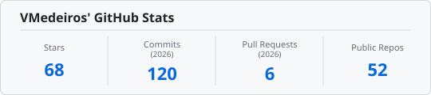

<!--
  The blocks marked cv:header, cv:about, cv:achievements, cv:stack,
  cv:experience, cv:projects, cv:languages, cv:education and cv:certifications come from
  the CV (https://victor-medeiros-cv.web.app) and are rewritten daily by
  .github/workflows/cv-sync.yml. Edit the CV, not those blocks.
-->

<!-- cv:header -->
<h1 align="center">José Victor Medeiros Leitão</h1>

  <strong>Frontend Tech Lead &amp; Senior Consultant | 9+ Years | Angular, Ionic &amp; React Specialist</strong>

<!-- /cv:header -->

  
  
  

---

## About Me

<!-- cv:about -->
Frontend Tech Lead with **9+ years** of experience building enterprise web and mobile applications for consulting clients, from architecture to production. Specialized in **Angular** and **Ionic**, also working with **React** and **Node.js**. I build Design Systems, set up CI/CD and automated quality gates, and lead distributed teams in English, Spanish and Portuguese. I use **GitHub Copilot and AI agents** in daily work for code review, tests and refactoring. Clients include **Thomson Reuters**, **Accenture/C6 Bank** and **Qodeture**, where I cut production defects through i18n work and moved releases from monthly to weekly.
<!-- /cv:about -->

---

## 🔭 Currently

- 🏗️ **Building:** Enterprise Angular applications as Frontend Tech Lead at **Ilegra**
- 📚 **Deep-diving:** Angular Signals, Zoneless architecture & NgRx Signal Store
- 🤖 **Exploring:** AI Agents for frontend workflows, such as automated code review, test generation and refactoring pipelines

---

## Key Achievements

<!-- cv:achievements -->
- Reduced production defects at **Thomson Reuters** with improvements focused on internationalization
- Decreased release cycle from **monthly to weekly** via CI/CD automation
- Mentored **12+ developers**, with several promoted to senior in a short period
- Delivered **trilingual platforms** (EN/ES/PT) for 3 enterprise clients in CRM, LegalTech & FinTech
<!-- /cv:achievements -->

---

## Tech Stack

<!-- cv:stack -->
<table>
  <tr>
    <td><strong>Frontend</strong></td>
    <td>Angular · Ionic · Capacitor · React · Next.js · TypeScript · JavaScript · RxJS · HTML5 · CSS3 · SCSS · Tailwind CSS</td>
  </tr>
  <tr>
    <td><strong>State Management</strong></td>
    <td>NgRx · NgRx Signal Store · Akita · Redux · Angular Signals · React Context / Hooks</td>
  </tr>
  <tr>
    <td><strong>Component Libraries</strong></td>
    <td>Angular Material · PrimeNG · Bento NG · Saffron · Materialize</td>
  </tr>
  <tr>
    <td><strong>Architecture</strong></td>
    <td>Clean Architecture · DDD · CQRS · Hexagonal Architecture · SOLID · Micro Frontends · Design Systems · Design Tokens · PWA · Offline-First · Service Workers · Reactive Programming</td>
  </tr>
  <tr>
    <td><strong>Testing &amp; Quality</strong></td>
    <td>Jest · Jasmine · Karma · Cypress · Playwright · ESLint · SonarQube · Automated Quality Gates</td>
  </tr>
  <tr>
    <td><strong>APIs &amp; Data</strong></td>
    <td>Node.js · GraphQL · REST APIs · Firebase / Firestore · IndexedDB (Dexie) · Google Maps / Places</td>
  </tr>
  <tr>
    <td><strong>Cloud &amp; DevOps</strong></td>
    <td>Firebase · AWS (S3, CloudFront) · Docker · Nginx · CI/CD · GitHub Actions · GitLab CI · Azure DevOps</td>
  </tr>
  <tr>
    <td><strong>Tools</strong></td>
    <td>Git · Nx · Jira · Confluence · Figma · Storybook · Postman · Node-RED · TFS</td>
  </tr>
  <tr>
    <td><strong>AI &amp; Productivity</strong></td>
    <td>GitHub Copilot · AI Agents · Prompt Engineering · AI-Assisted Code Review · Generative AI Workflows</td>
  </tr>
  <tr>
    <td><strong>Leadership &amp; Process</strong></td>
    <td>Technical Leadership · Mentoring · Code Review Culture · PR Standards · Agile · Scrum · Sprint Planning · Internationalization (i18n, l10n) · Strategic Planning · Multidisciplinary Team Coordination · Prototyping · UI/UX Design · Conventional Commits · ADRs · Docs as Code</td>
  </tr>
</table>
<!-- /cv:stack -->

---

## Experience Timeline

<!-- cv:experience -->
| Period | Role | Company |
| --- | --- | --- |
| 10/2021 - Present | Frontend Consultant & Technical Leader | **Ilegra** · Campina Grande, PB (Remote) |
| 04/2021 - 10/2021 | Frontend Architect & Consultant | **Icon Solutions Brasil** · Remote |
| 10/2017 - 03/2024 | Senior Frontend Developer & Specialist | **Stefanini Labs** · Campina Grande, PB |
| 03/2017 - 10/2017 | Web & Mobile Frontend Developer | **LTI Unifacisa** · Campina Grande, PB |
<!-- /cv:experience -->

---

## 🌟 Featured Projects

<!-- cv:projects -->
| Project | Description | Stack |
| --- | --- | --- |
| [**FinSmart AI**](https://finsmart-ai-236747414590.us-west1.run.app/) | Personal finance PWA with a multilingual AI advisor: natural-language entries, receipt reading from photos and investment suggestions. | Angular 21 · Gemini · D3.js · Tailwind CSS · PWA |
| [**JudoKan**](https://judokan-app.web.app/) | Management system for judo academies: students, belts, classes, attendance and payments, with admin, instructor and student roles (in development). | Angular 21 · Firebase · Tailwind CSS · Playwright |
| [**Nexus Enterprise**](https://nexus-enterprise-time.web.app/) | Operations platform that tracks worked hours against contracts, warns before a budget runs out and controls access by role (in development). | Angular 19 · Signals · Tailwind CSS · Chart.js · Firebase · PWA |
| [**Judô Master**](https://vmedeiros.github.io/Judo-Master/) | Angular app to study and manage judo techniques by belt, with filtering, editing and persistent light and dark themes. | Angular 21 · Signals · Tailwind CSS |
| [**Holy Bible**](https://holy-bible-ai.web.app/) | Bible study app with several versions and languages, bookmarks and AI analysis of each verse's context, with Google sign-in and sync. | Next.js · Genkit · Gemini · Firebase · Tailwind CSS |
| [**AI Portfolio Pro**](https://local-personal-projects.web.app/132iaWrzuJb6TeCAQKTV0d3UGiS2) | Platform to build and publish developer portfolios, with AI help to write and summarize projects. My portfolio runs on it. | Next.js 15 · Genkit · Gemini · Firestore · Tailwind CSS · shadcn/ui |
| [**Plotly 3D Converter**](https://studio--studio-5317256297-84121.us-central1.hosted.app/) | Upload, customize and preview 3D models (.obj, .html) and generate embeddable HTML, with cloud storage on Firebase. | Next.js 15 · Plotly · Firebase · Tailwind CSS |
| [**Optimal Trainer**](https://studio--studio-872593168-6907d.us-central1.hosted.app/) | Fitness and nutrition coach that uses generative AI to create workout and meal plans for each user's profile and goals (in development). | Next.js 15 · Genkit · Gemini · Firebase · Framer Motion |
| [**CryptoWise**](https://studio--studio-5697503725-469fe.us-central1.hosted.app/) | Tracker for selected cryptocurrencies with AI-generated insights and recommendations (in testing). | Next.js · LLM · Firebase |
<!-- /cv:projects -->

Also: the [Interactive CV](https://victor-medeiros-cv.web.app/) itself (trilingual, with ATS-friendly PDF and DOCX generated in the browser) and [Interview Prep](https://front-prep.web.app/), an interview guide for Frontend and Tech Lead roles.

---

## Contribution Activity

<picture>
  <source media="(prefers-color-scheme: dark)" srcset="https://raw.githubusercontent.com/VMedeiros/VMedeiros/output/github-snake-dark.svg" />
  <source media="(prefers-color-scheme: light)" srcset="https://raw.githubusercontent.com/VMedeiros/VMedeiros/output/github-snake.svg" />
  
</picture>

<picture>
  <source media="(prefers-color-scheme: dark)" srcset="https://raw.githubusercontent.com/VMedeiros/VMedeiros/output/contribution-progress-dark.svg" />
  <source media="(prefers-color-scheme: light)" srcset="https://raw.githubusercontent.com/VMedeiros/VMedeiros/output/contribution-progress.svg" />
  
</picture>

---

## 📊 GitHub Stats

<picture>
  <source media="(prefers-color-scheme: dark)" srcset="https://raw.githubusercontent.com/VMedeiros/VMedeiros/output/github-stats-dark.svg" />
  <source media="(prefers-color-scheme: light)" srcset="https://raw.githubusercontent.com/VMedeiros/VMedeiros/output/github-stats.svg" />
  
</picture>

Snake, contribution bar and stats are regenerated daily by [this workflow](.github/workflows/snake.yml).

---

## Languages

<!-- cv:languages -->
| Portuguese | English | Spanish |
| :-: | :-: | :-: |
| Native | Fluent | Fluent |
<!-- /cv:languages -->

---

## Education

<!-- cv:education -->
- **Postgraduate Degree in Mobile Device Development**, Unifacisa | Campina Grande, PB | 2018
- **Bachelor's Degree in Information Systems**, Unifacisa | Campina Grande, PB | 2017
<!-- /cv:education -->

---

## Certifications & Continuous Learning

<!-- cv:certifications -->
- **Angular University:** Angular Signals In Depth (Angular 19), RxJS In Practice, Reactive Angular Course (Angular 16), Angular Advanced MasterClass
- **Udemy:** ChatGPT Masterclass
<!-- /cv:certifications -->
- **Ongoing:** AI-Powered Development & Prompt Engineering

---

  <a href="https://victor-medeiros-cv.web.app/">🔗 View Full Interactive CV</a>

